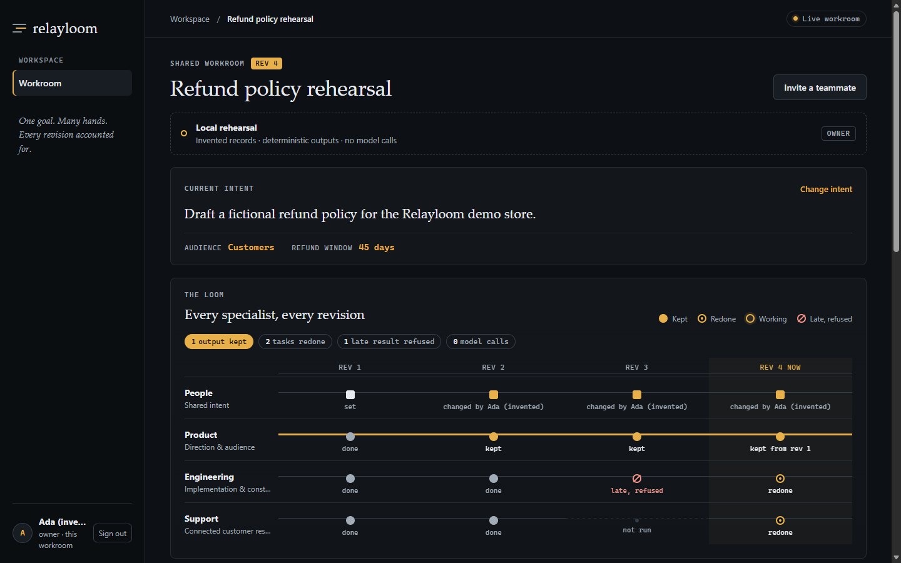

# Relayloom

Relayloom is a shared workroom where people and AI specialists work on one goal
in parallel. When someone changes the goal, it keeps the work that is still
valid, redoes only what the change touched, and publishes only after a recorded
approval and a check of the outcome.

```sh
python -m relayloom --port 8800
```

Then open http://127.0.0.1:8800. Python 3.11 or later, nothing to install.
On Windows `.\demo.ps1` does the same and opens the browser; elsewhere `./demo.sh`.

**Status.** Runnable local rehearsal: invented records and deterministic
specialist outputs written by code, zero model calls. A Meta adapter is built
and offline tested; **live Meta inference has not been run yet.** MIT license.

**Hackathon.** Built for the Meta Global AI Developer Hackathon, Startup track.
Every commit is after the 26 October kickoff; the eligible build start is
unconfirmed. See [docs/HACKATHON_UPDATES.md](docs/HACKATHON_UPDATES.md).



*Rehearsal screenshot, invented records. The loom shows each specialist across
revisions: kept, redone, or late and refused.*

## Try it

1. **Create a workroom.** You become its owner.
2. **Run specialists.** Product and Engineering start together; Support waits
   for both. The workroom shows real server state as it changes.
3. **Change intent.** Set the refund window to another number. Product's work is
   kept; Engineering and Support are redone.
4. **Change it again while Engineering is working.** The late result from the old
   revision is refused, not used.
5. **Approve and publish.** Tick "Approve publication of this revision", then
   publish. The workroom shows the request, the recorded decision and the
   outcome check. "Verified outcome" appears only when that check passes.

Optional: invite an editor or viewer and join from a second browser profile.
Invites are single use and expire after 30 minutes.

Check the whole flow without a browser:

```sh
python scripts/check_demo.py        # or scripts/check_demo.ps1, scripts/check_demo.sh
```

It prints PASS or FAIL for: create a workroom, parallel specialists, intent
change with reuse, stale output rejected, publication needing a recorded
approval, verified outcome, and intent text unable to change a limit.

## Autonomy where safe, approval where it matters, proof after every action

Each operation has a level in [`relayloom/policy.json`](relayloom/policy.json),
read once at startup. Requests, intent text and model output cannot change it.

| Operation | Level |
| --- | --- |
| Explain what changed | Assist |
| Specialist drafts | Draft |
| Run ready specialists | Execute within limits: 9 runs per revision, no automatic retry |
| Meta API request | Execute within limits: durable attempt ledger, no automatic retry |
| Publish the artifact | Execute with approval: owner, one revision, one local artifact |

Publication needs a recorded approval (who, which action, when, which limit).
After publishing, the stored artifact is read back and compared with that
record: VERIFIED, FAILED, or UNKNOWN until a read-only check succeeds. Details
and the tests behind each point: [docs/AUTONOMY.md](docs/AUTONOMY.md).

## Meta models

The optional adapter in `relayloom/meta.py` speaks the documented Chat
Completions protocol with structured output, sends only a fixed public fixture,
and records every attempt in a durable ledger before dispatch. It never starts
by default and never prints the key. Without the required environment
variables it refuses to start and names them.

`scripts/check_meta.ps1 --i-have-credit` (or `.sh`) makes one billable request
and prints PASS or FAIL per case. Without that flag it refuses and sends
nothing. It has not been run. See [docs/META.md](docs/META.md).

## Tests

```sh
python -m unittest discover -s tests -v    # 42 tests
node --test tests/ui.test.cjs              # 12 tests
```

They cover roles, sessions, CSRF, one-time invites, parallel work, dependency
waiting, selective reuse, stale output, malformed evidence, approval records,
run limits, outcome checks, restart recovery, HTTP boundaries and the Meta
refusal paths (fake transports only). These are rehearsal results, not live
Meta or customer outcomes.

## Read more

- [Autonomy and approval](docs/AUTONOMY.md)
- [Hackathon updates by commit](docs/HACKATHON_UPDATES.md)
- [Video script](docs/VIDEO_SCRIPT.md)
- [Submission notes](SUBMISSION_META.md)
- [Product and architecture](docs/PRODUCT.md)
- [Implementation checkpoint](docs/IMPLEMENTATION.md)
- [Meta adapter boundary](docs/META.md)
- [Contribution record](docs/HACKATHON_PROVENANCE.md)
- [Security and privacy](SECURITY.md)

Use invented information only. This is a loopback rehearsal, not a hosting
service; do not expose its port through a proxy or tunnel. Records stay in the
ignored `data/relayloom.sqlite3` file.

## License and authorship

MIT. Original work by Sriharsan B S. No customers, pilots, revenue or funding
are claimed.
